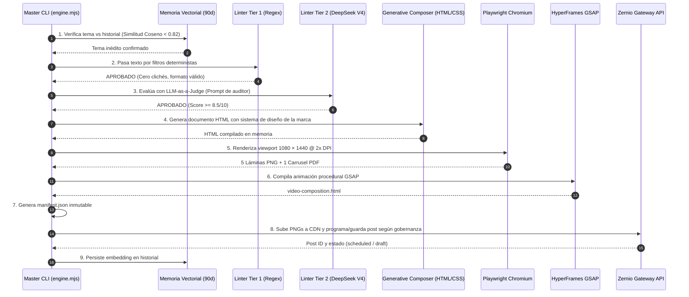

# Brand OS Engine Multi-Brand OS — Arquitectura del Sistema

Este documento describe la arquitectura general de **Brand OS Engine**, un sistema desacoplado, multi-marca y nativo en código para la producción, auditoría y publicación automatizada de carruseles de alta gama en Instagram y LinkedIn.

---

## 1. Principios Fundamentales del Sistema

1. **Cero Plantillas Estáticas (Zero-Template Generative Engine):** Las piezas gráficas no provienen de Figma ni de plantillas de Canva. Son ensambladas algorítmicamente en HTML5/CSS3 moderno y renderizadas mediante un navegador Chromium headless en tiempo real.
2. **Separación Estricta entre Decisión (IA) y Ejecución (Código Determinista):** Los modelos de IA no dibujan ni calculan posiciones de píxeles; la IA se limita a la auditoría semántica y a la adaptación de mensajes. Toda la geometría, tipografía, exportación y despacho es código determinista puro.
3. **Auditoría Bicameral Inmutable:** Ninguna pieza gráfica se compila ni se publica si no supera una compuerta determinista por expresiones regulares (Tier 1) y un juez semántico LLM (Tier 2) con una calificación mínima de **8.5 / 10**.
4. **Gobernanza Aislada por Marca:**
   - **{{MARCA_B2B}}:** 100% Autónomo (Zero Human-in-the-Loop).
   - **{{MARCA_APP}}:** 100% Autónomo (Zero Human-in-the-Loop).
   - **{{NOMBRE_CREADOR}} {{APELLIDO_CREADOR}} (Marca Personal):** Modo Copiloto estricto (Human-in-the-Loop). Nunca publica sin confirmación explícita (`--approve`).

---

## 2. Mapa Estructural del Repositorio

```
Brand OS Engine/
├── engine.mjs                       # Orquestador Master CLI (schedule, test, run, repurpose, status)
├── package.json                     # Scripts y dependencias operativas
│
├── core/                            # NÚCLEO COMPARTIDO (100% Reutilizable)
│   ├── config.mjs                   # Carga de entorno (.env), rutas absolutas y credenciales
│   ├── linter/
│   │   ├── deterministic.mjs        # Tier 1: Blacklist regex de clichés, humo y reglas de formato
│   │   └── semantic-judge.mjs       # Tier 2: LLM-as-a-Judge parametrizable por marca (DeepSeek V4)
│   ├── renderer/
│   │   ├── generative-composer.mjs  # Generador algorítmico de HTML/CSS según la marca
│   │   ├── playwright.mjs           # Factoría Chromium Headless (1080 × 1440 @ 2x DPI -> PNG + PDF)
│   │   └── hyperframes-motion.mjs   # Animador de línea de tiempo con GSAP (Zero-Remotion)
│   ├── publisher/
│   │   └── zernio.mjs               # Gateway de subida CDN y programación API a Zernio
│   ├── memory/
│   │   └── vector-memory.mjs        # Hashing de embeddings locales y similitud coseno (90 días)
│   └── repurposer/
│       └── cross-pollinate.mjs      # Adaptador de 1 hecho operativo real -> 3 piezas por marca
│
├── brands/                          # CONFIGURACIONES Y ACTIVOS POR MARCA
│   ├── brand-enterprise/                         # {{MARCA_B2B}} (B2B COO / Infraestructura $5,000/mes)
│   │   ├── brand.json               # Metadatos, colores, voz, gobernanza y cuenta destino
│   │   └── topics.mjs               # Ontología editorial y temas predefinidos
│   ├── brand-saas/                       # {{MARCA_APP}} (App Creadores / "De la idea al calendario")
│   │   ├── brand.json
│   │   └── topics.mjs
│   └── brand-personal/                      # {{NOMBRE_CREADOR}} {{APELLIDO_CREADOR}} (Marca Personal / Build in Public con vos)
│       ├── brand.json
│       ├── voice.md                 # Manifiesto estilístico de voz en primera persona
│       └── topics.mjs
│
├── docs/                            # DOCUMENTACIÓN TÉCNICA
│   ├── 01-architecture-overview.md  # Este archivo
│   ├── 02-ai-vs-deterministic.md    # Frontera entre Inteligencia Artificial y Código Puro
│   ├── 03-design-system.md          # Especificación visual de cada marca (Fuentes, CSS, Grillas)
│   ├── 04-cadence-and-governance.md # Cadencia semanal, horarios y reglas de publicación Zernio
│   └── 05-ingestion-and-memory.md   # Flujos de entrada de temas y deduplicación semántica
│
└── dist/                            # SALIDA DE COMPILACIÓN LOCAL (Inmutable y versionada por timestamp)
    ├── memory/                      # Historial de embeddings por marca (*-memory.json)
    ├── brand-enterprise/                         # Carpetas con PNGs, PDF, HTML y manifest.json de {{MARCA_B2B}}
    ├── brand-saas/                       # Carpetas de salida de {{MARCA_APP}}
    └── brand-personal/                      # Carpetas de salida de {{NOMBRE_CREADOR}} {{APELLIDO_CREADOR}}
```

---

## 3. Diagrama de Flujo End-to-End


